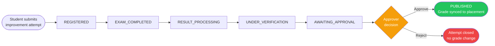
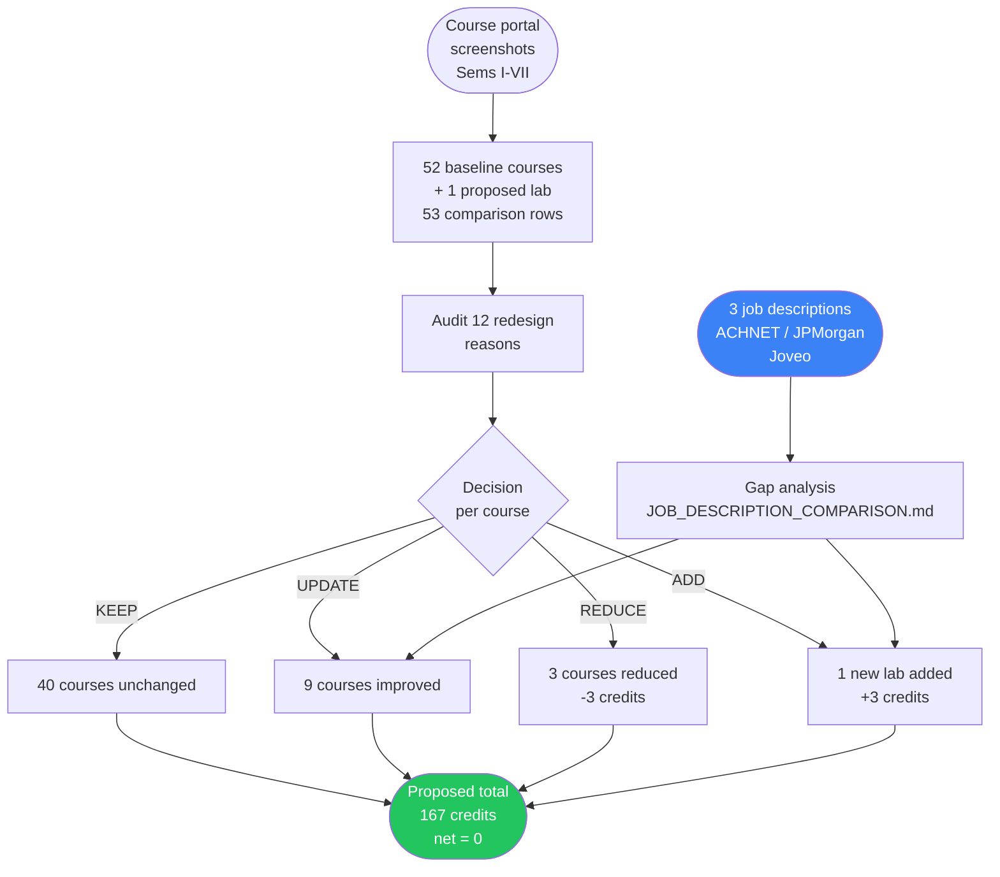

# HKAIVERSE Round 2 — Submission Repository

**Participant:** kanwa2006
**Round:** HKAIVERSE Round 2
**Submission deadline:** 24 October 2026, 11:59 PM IST

---

## Repository Structure

| Folder | Task | Status |
|---|---|---|
| [`Task1/`](Task1/) | Investigate a college workflow — ResultFlow | Complete |
| [`Task2/`](Task2/) | Curriculum audit and redesign — B.Tech CSE, IFHE, Batch 2023–2027 | Complete |

---

## Task 1 — ResultFlow

**Topic:** Investigating the result-publication delay for Summer Term grade-improvement attempts at IFHE Hyderabad and proposing a structured, transparent workflow (ResultFlow) to reduce student uncertainty during placement processing.

**Problem in one line:** A student waited 90 days for a grade-improvement result. During that time, the placement form treated the pending subject as a backlog — making a student with passing grades appear blocked.

**How ResultFlow improves this:**

**Key documents:**
- [`Task1/README.md`](Task1/README.md) — full project overview, evidence log, workflow design, and test summary
- [`Task1/TASK1_REPORT.md`](Task1/TASK1_REPORT.md) — detailed investigation report
- [`Task1/prototype/`](Task1/prototype/) — Python prototype (`resultflow.py`), test suite (`test_resultflow.py`), and ROI script
- [`Task1/evidence/`](Task1/evidence/) — screenshot evidence, pytest output, case results, and ROI output

**Test command:** `python -m pytest Task1/prototype/ -q` (20/20 automated tests pass; validates state machine transitions, idempotent sync retries, duplicate rejection, and role-based permissions).

---

## Task 2 — Curriculum Audit and Redesign

**Topic:** Auditing the B.Tech CSE curriculum at IFHE Hyderabad (batch 2023–2027) and proposing a balanced redesign that retains strong theoretical foundations while adding more practical, project-based learning aligned with entry-level industry requirements.

**Problem in one line:** Students can complete individual subjects in isolation without structured opportunities to integrate them — whereas industry roles require practical end-to-end integration (APIs, databases, and version control for software roles; hands-on SQL and data modeling for analytics roles).

**How the audit was structured:**

**Key documents:**
- [`Task2/README.md`](Task2/README.md) — main entry point: problem statement, proposed changes, evidence summary, and all links
- [`Task2/CURRICULUM_AUDIT.md`](Task2/CURRICULUM_AUDIT.md) — full course map (52 baseline + 1 proposed lab = 53 rows), 12 redesign reasons, KEEP/UPDATE/REDUCE/ADD decisions
- [`Task2/CREDIT_CALCULATIONS.md`](Task2/CREDIT_CALCULATIONS.md) — transparent credit calculations (baseline 167 cr → proposed 167 cr, 19.8% primary method)
- [`Task2/JOB_DESCRIPTION_COMPARISON.md`](Task2/JOB_DESCRIPTION_COMPARISON.md) — three on-campus job descriptions (ACHNET, JPMorgan, Joveo) compared across distinct role tracks
- [`Task2/AI_EXERCISES.md`](Task2/AI_EXERCISES.md) — five AI-assisted exercises with verification, live execution outputs, and reflections
- [`Task2/LAB_CAPSTONE_PROPOSAL.md`](Task2/LAB_CAPSTONE_PROPOSAL.md) — Applied Software Product Engineering Lab proposal (building on ResultFlow state-machine design)
- [`Task2/course_explorer.html`](Task2/course_explorer.html) — interactive course explorer (open locally in any browser)
- [`Task2/CURRICULUM_SCREENSHOTS.md`](Task2/CURRICULUM_SCREENSHOTS.md) — index and reconciliation of semester-wise course portal screenshots
- [`Task2/SOURCES.md`](Task2/SOURCES.md) — all sources, access dates, evidence categories
- [`Task2/FEEDBACK_AND_LIMITATIONS.md`](Task2/FEEDBACK_AND_LIMITATIONS.md) — feedback, personal contribution, limitations, validation status
- [`Task2/tests/test_course_explorer.py`](Task2/tests/test_course_explorer.py) — automated test suite (15 automated Python checks pass)

**Evidence files:**
- [`Task2/assets/`](Task2/assets/) — 7 semester-wise course portal screenshots (Sems I–VII)
- [`Task2/job_descriptions/`](Task2/job_descriptions/) — 3 job description PDFs: ACHNET SDE, JPMorgan Data Analyst, Joveo Full-Stack Intern

**Test command:** `python Task2/tests/test_course_explorer.py` (15/15 automated programmatic checks pass; validates course data, filter logic, credit arithmetic, and zero-credit courses).

**Status:** Complete. Proposal only — not an approved IFHE policy document.

---

## Release and Commit

- **Named final release:** [v2.1-final-submission](https://github.com/kanwa2006/hkaiverse/releases/tag/v2.1-final-submission) (*HKAIVERSE Round 2 — Final Content, Safety and Release Audit*)
- **Preserved content review commit:** [`151e371`](https://github.com/kanwa2006/hkaiverse/commit/151e371e894b6dd296a6c68209730da5624f9976)
- **Full 40-character SHA:** `151e371e894b6dd296a6c68209730da5624f9976`
- **Commit URL:** [https://github.com/kanwa2006/hkaiverse/commit/151e371e894b6dd296a6c68209730da5624f9976](https://github.com/kanwa2006/hkaiverse/commit/151e371e894b6dd296a6c68209730da5624f9976)
- **Prior preserved release:** [v2.0-task2-final](https://github.com/kanwa2006/hkaiverse/releases/tag/v2.0-task2-final) (preserved historical review at commit [`8dc4a56`](https://github.com/kanwa2006/hkaiverse/commit/8dc4a5650eb8d4721f8717c6fadc85632e7da693))

*Note on release tracking:* The published release tag `v2.1-final-submission` permanently marks and preserves the verified content audit commit `151e371e894b6dd296a6c68209730da5624f9976`. This follow-up documentation commit on `main` updates the release cross-reference in the README without altering the preserved audit content.

---

*All prototype data is synthetic. No real student names, IDs, marks, fees, credentials, or private messages are included in this repository.*
